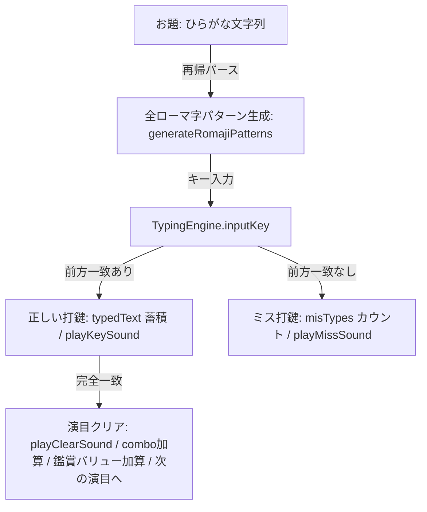

# バレエ打 (Ballet Typing) システム設計書 (ARCHITECTURE.md)

本ドキュメントは、「バレエ打 (Ballet Typing - The Theater -)」の設計思想、構造、およびデータフローを記述するものです。

---

## 1. ディレクトリ構造

```text
BalletTyping/
├── package.json
├── tsconfig.json
├── next.config.ts
├── eslint.config.mjs
├── vitest.config.mts
└── src/
    ├── app/
    │   ├── layout.tsx     # ルートレイアウト（タイトル: "バレエ打 - The Classical Theater -"）
    │   ├── globals.css    # 劇場・バレエテーマ専用スタイルシート
    │   ├── page.tsx       # エントリーポイント（直接ゲームが起動）
    │   └── page.test.tsx  # ロビー画面描画テスト
    ├── components/
    │   ├── GameMenu.tsx   # 座席選択・開演画面
    │   ├── PlayScreen.tsx # 舞台ステージ・タイピングプレイ画面
    │   └── ResultScreen.tsx # カーテンコール・リザルト画面
    └── utils/
        ├── balletData.ts  # 120語の演目・人物・ステップデータ
        ├── typingEngine.ts# マルチローマ字入力エンジン（外来語音韻対応）
        ├── typingEngine.test.ts # 単体テスト
        └── sound.ts       # 劇場音響シンセサイザー（Web Audio API）
```

---

## 2. コアロジックとデータフロー



- **ハードウェアアクセラレーション描画**:
  舞台上のモチーフは React の再レンダリングを介さず、Direct DOM Ref と `transform: translate3d(...)` によりブラウザの GPU Compositor で直接 60/120fps の滑らかな等速運動を実現。
- **重複防止**:
  Fisher-Yates アルゴリズムによるシャッフルキュー方式で、全単語が一巡するまで同じお題は出題されません。
